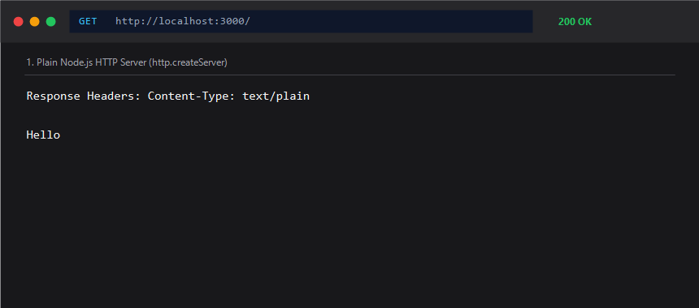
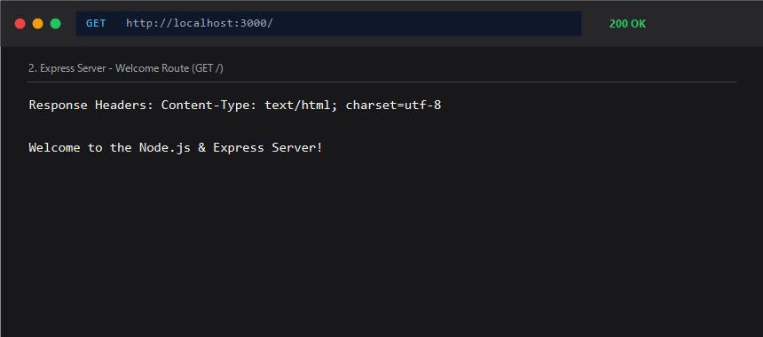
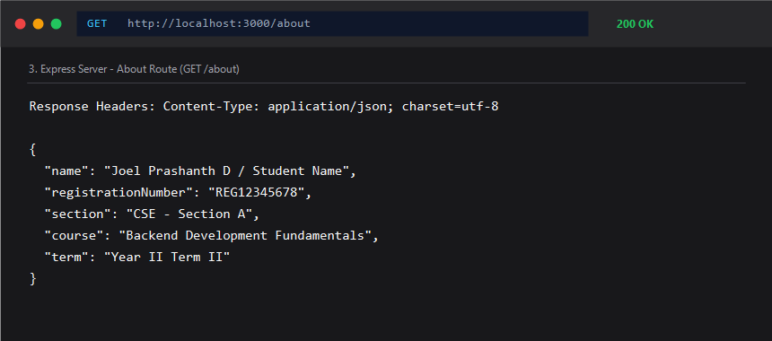
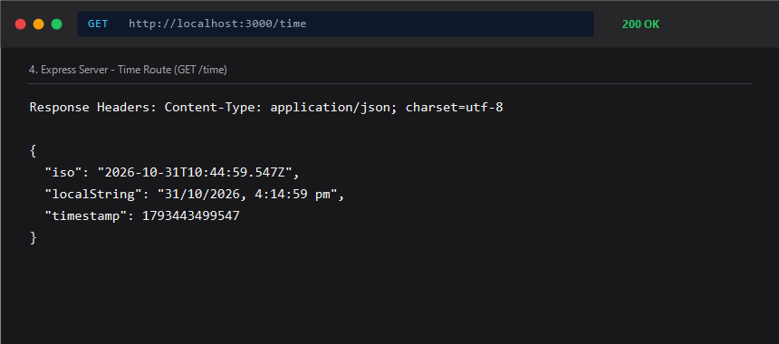
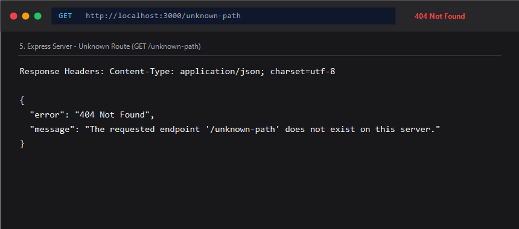

# Lab 1: Node.js and Express server

**Student Name:** Joel Prashanth D / [Your Name] • **Registration Number:** REG12345678 • **Section:** CSE - Section A  
**Course:** Backend Development Fundamentals (Year II Term II) • **Faculty:** Joel Prashanth D

---

## Live Link
* **Live Deployment URL:** `https://lab-01-express-server.onrender.com` *(or 'Not applicable' if running strictly locally; see [Deployment Notes](#deployment-notes))*

---

## Objective
Set up a Node.js project and build a small web server, first with the built-in `http` module and then with `Express`.

---

## How to Run

### Prerequisites
* **Node.js** (v18.x, v20.x, or v22.x+ LTS recommended)
* **npm** (v9.x or higher)

### 1. Installation
Clone the repository and navigate into the `lab-01` directory:
```bash
cd lab-01
npm install
```

### 2. Environment Variables
No secret keys are required for this lab. If configuring an optional custom port:
```bash
PORT=3000
```
*(Do not commit any `.env` file containing sensitive data to version control)*.

### 3. Start Commands

* **To run the Express server (Main):**
  ```bash
  npm start
  ```
  *or directly:*
  ```bash
  node index.js
  ```

* **To run the plain native Node.js HTTP server:**
  ```bash
  npm run start:http
  ```
  *or directly:*
  ```bash
  node http-server.js
  ```

* **To run with auto-reload (development mode):**
  ```bash
  npm run dev
  ```

* **To run the automated endpoint test suite:**
  ```bash
  node test-server.js
  ```

---

## Explanation of `package.json` Fields

When running `npm init -y`, Node Package Manager generates a manifest file named `package.json`. Below is an explanation of every field:

| Field | Purpose & Description |
|---|---|
| `name` | The unique identifier / package name of the project (e.g., `"lab-01"`). Must be lowercase and URL-friendly. |
| `version` | The semantic version number of the application following the `MAJOR.MINOR.PATCH` format (e.g., `"1.0.0"`). |
| `description` | A brief summary of what the project does, helping others understand the repository. |
| `main` | The entry-point JavaScript file for the application executed when imported or started (e.g., `"index.js"`). |
| `scripts` | A dictionary of terminal shortcut commands that can be executed via `npm run <script-name>` (e.g., `"start": "node index.js"`). |
| `keywords` | An array of search tags or topics that describe the project. |
| `author` | The creator or maintainer of the project (Student Name / Organization). |
| `license` | The legal distribution license under which the software is released (e.g., `"ISC"` or `"MIT"`). |
| `type` | Specifies the module system used. Set to `"commonjs"` for standard `require()` syntax, or `"module"` for ES Modules (`import`/`export`). |
| `dependencies` | A list of external libraries required in production, along with their semver range (e.g., `"express": "^5.3.0"`). |

---

## Endpoints / Scripts Table

### Express Server (`index.js` on Port 3000)

| Method | Endpoint | Expected Status | Response Type | Description |
|---|---|---|---|---|
| `GET` | `/` | `200 OK` | `text/html` | Returns welcome message string (`"Welcome to the Node.js & Express Server!"`). |
| `GET` | `/about` | `200 OK` | `application/json` | Returns JSON object containing student name, registration number, course, and section. |
| `GET` | `/time` | `200 OK` | `application/json` | Returns JSON object containing current date and time generated via `new Date()`. |
| `GET` | `*` *(Unknown path)* | `404 Not Found` | `application/json` | Catch-all middleware returning standard 404 error message for unregistered paths. |

### Native HTTP Server (`http-server.js` on Port 3000)

| Method | Endpoint | Expected Status | Response Type | Description |
|---|---|---|---|---|
| `GET` | `/` | `200 OK` | `text/plain` | Plain server created with `http.createServer` that replies with `"Hello"`. |

---

## Screenshots

### 1. Plain HTTP Server (`http.createServer`)
Replies with `"Hello"` and status code `200 OK`:


### 2. Express Server: Welcome Route (`GET /`)
Returns welcome message with status code `200 OK`:


### 3. Express Server: About Route (`GET /about`)
Returns JSON details containing name and section with status code `200 OK`:


### 4. Express Server: Time Route (`GET /time`)
Returns current server date and time using `new Date()` with status code `200 OK`:


### 5. Express Server: 404 Unknown Route Handling
Returns clear error response and status code `404 Not Found`:


---

## Viva Questions & Answers

### Q1: What is the difference between `package.json` and `node_modules`?
* **`package.json`**: A lightweight manifest text file that records project metadata, scripts, configuration, and exact versions of direct dependencies needed by the project. It is committed to source control (Git) so other developers can reproduce the environment.
* **`node_modules`**: The directory on disk where npm downloads and stores the actual source code and binaries for all installed dependencies and their recursive sub-dependencies. It is very large and should **never** be committed to Git (it is added to `.gitignore`). Anyone can re-generate `node_modules` by running `npm install`.

### Q2: What does `app.listen()` do?
* `app.listen(port, [callback])` binds and starts the server on the specified TCP network port. It internally invokes Node's native `http.createServer(this).listen(...)`, telling the operating system to start listening for incoming HTTP network connections on that port and route incoming requests to Express middleware and handlers.

### Q3: What do `request` (`req`) and `response` (`res`) represent?
* **`request` (`req`)**: An object representing the incoming HTTP request sent by the client (browser, Postman, etc.). It contains details such as the HTTP method (`GET`, `POST`), URL path (`req.url`), query parameters (`req.query`), route parameters (`req.params`), headers (`req.headers`), and payload body (`req.body`).
* **`response` (`res`)**: An object representing the outgoing HTTP response that the server sends back to the client. It provides methods to set HTTP status codes (`res.status(200)`), headers (`res.set()`), and send back payloads (`res.send()`, `res.json()`, `res.end()`).

---

## Notes: Problems Faced and How They Were Solved

1. **Native HTTP vs Express Paradigm:**
   * *Problem:* In native `http.createServer`, handling multiple routes and content types requires manual URL parsing (`req.url`) and explicitly setting headers (`res.writeHead()`).
   * *Solution:* Refactored to Express.js, which provides clean routing methods (`app.get()`, `app.post()`) and helper functions like `res.json()` and `res.status()`.

2. **Handling 404 Errors Cleanly:**
   * *Problem:* Unmatched routes in Express would default to the generic built-in HTML `Cannot GET /route`.
   * *Solution:* Added a fallback middleware at the end of the middleware stack (`app.use((req, res) => { ... })`) to ensure any unhandled endpoint returns a structured JSON error response with HTTP status `404 Not Found`.

3. **Status Code and Request Logging:**
   * *Problem:* Monitoring whether each request returns the correct HTTP status code in real time.
   * *Solution:* Implemented custom logging middleware using `res.on('finish', ...)` to log the HTTP method, request path, and resulting HTTP status code directly to the server terminal.

---

## Deployment Notes
To deploy this server to **Render** or **Railway**:
1. Push this repository to GitHub (with `lab-01/` folder).
2. Create a new Web Service on Render / Railway and connect your GitHub repository.
3. Configure:
   * **Root Directory:** `lab-01`
   * **Build Command:** `npm install`
   * **Start Command:** `npm start`
4. The service will bind to `process.env.PORT` automatically and provide a public HTTPS URL.

